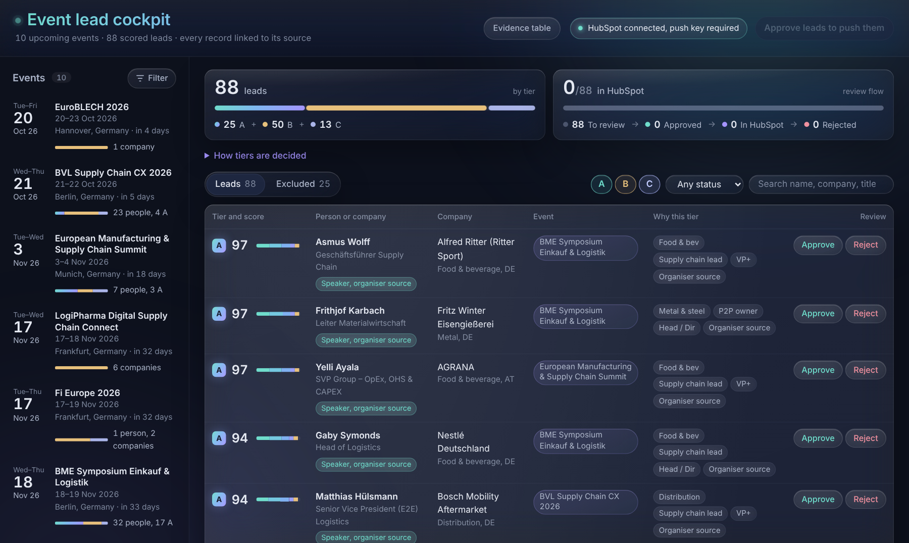
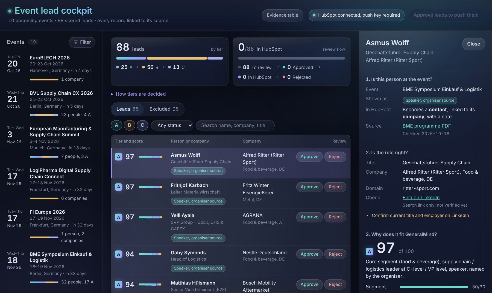
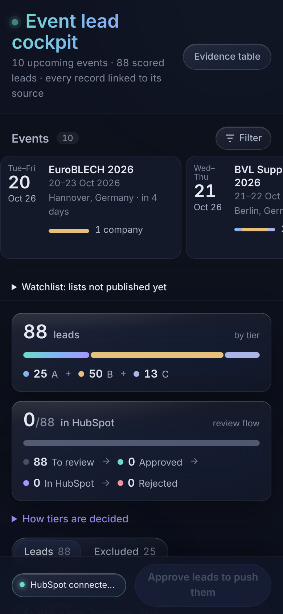

# Event Lead Cockpit

**GTM Engineer case study for GeneralMind.**
Ten upcoming events where GeneralMind's buyers will be, the people and companies publicly confirmed
at each one, scored against GeneralMind's ICP, reviewed by a human and pushed to HubSpot.

| | |
| --- | --- |
| **Cockpit** | https://event-lead-cockpit.vercel.app |
| **Evidence table** (every record and its source, no JavaScript) | https://event-lead-cockpit.vercel.app/evidence.html |
| **Data checked on** | 16 October 2026 |



---

## At a glance

| | |
| --- | --- |
| Events | 10, from 20 Oct 2026 to 18 Mar 2027, all in Germany (Berlin, Munich, Frankfurt, Düsseldorf, Hannover, Essen) |
| Records collected | 113 people and companies, each linked to the page that names them |
| Leads | **88** (25 A, 50 B, 13 C): 79 people, 9 companies |
| Excluded | 25 sellers, advisers, organisers and former staff, kept out of the CRM |
| CRM | Approved leads are written to HubSpot as contact + company + note |

## The three questions every lead answers

Open any lead and the detail panel is organised around three questions. A lead that cannot answer
all three does not make it into the cockpit.

1. **Is this person or company at the event?** The exact role the source states: speaker named by the
   organiser, speaker on a third-party listing, speaking company, exhibitor, exhibitor staff or
   sponsor. Attendee lists are never public, so nobody is called an "attendee". Each source is
   checked for the **current edition**: an old lineup on a new page does not count.
2. **Is the role right?** The published title, plus a LinkedIn search link for a human to confirm it.
   Titles are not verified automatically and the cockpit says so.
3. **Why does it fit GeneralMind?** A tier (A/B/C) with a written reason, a 0–100 score broken down by
   segment, function, seniority, region and evidence, and the closest GeneralMind customer story as
   a suggested opener.



The cockpit also works on a phone, with a fixed push bar at the bottom:



## The ten events

| Date | Event | City | What the source confirms | Leads (A / B / C) |
| --- | --- | --- | --- | --- |
| 20–23 Oct 2026 | EuroBLECH 2026 | Hannover | Exhibiting company | 1 (0 / 1 / 0) |
| 21–22 Oct 2026 | BVL Supply Chain CX 2026 | Berlin | Speakers on the organiser's 2026 page | 23 (4 / 15 / 4) |
| 3–4 Nov 2026 | European Manufacturing & Supply Chain Summit | Munich | Speakers on the organiser's 2026 page | 7 (3 / 2 / 2) |
| 17–18 Nov 2026 | LogiPharma Digital Supply Chain Connect | Frankfurt | Speaking companies | 6 (0 / 6 / 0) |
| 17–19 Nov 2026 | Fi Europe 2026 | Frankfurt | Exhibitors with stand numbers | 3 (0 / 2 / 1) |
| 18–19 Nov 2026 | BME Symposium Einkauf & Logistik | Berlin | Speakers in the organiser's programme PDF | 32 (17 / 11 / 4) |
| 23–24 Nov 2026 | EUROMETAL Steel Trade Day 2026 | Düsseldorf | Speakers on the organiser's page | 3 (0 / 1 / 2) |
| 25–26 Nov 2026 | Handelsblatt Industrie-Gipfel 2026 | Düsseldorf | Speakers who "haben ihr Kommen zugesagt" | 6 (0 / 6 / 0) |
| 1–2 Dec 2026 | TFEST26 Supply Chain Transformation Event | Berlin | Speaker pages marked "Speaking at TFEST26" | 5 (1 / 4 / 0) |
| 17–18 Mar 2027 | Handelsblatt Zukunft Stahl 2027 | Essen | First confirmed 2027 speakers | 2 (0 / 2 / 0) |

Why each event matters for GeneralMind is written in [`data/raw/events.json`](data/raw/events.json)
and shown in the cockpit when you select an event. A **watchlist** of nine more events (EP&SCE 2027,
DSAG Technologietage, HANNOVER MESSE and others) waits for its lists to be published.

## How it works

```
data/raw/events.json       10 events + watchlist: dates, city, why it matters, source
data/raw/people.json       113 records from public speaker / exhibitor / sponsor pages
data/raw/companies.json    enrichment seed: company type, segment, country, domain
config/icp.json            ICP: segments, functions, seniority, tier rules, weights
          │
          ▼
scripts/build.py           route → classify → score → tier → merge duplicates
          │
          ├──▶ data/cockpit.json   data for the cockpit and the HubSpot function
          └──▶ evidence.html       the same records as a plain table
          │
          ▼
index.html + app.js        review: filter, inspect, approve or reject
          │   (sends lead IDs only)
          ▼
api/hubspot.js             Vercel function: writes approved leads to HubSpot
```

### 1. Route
Every record lands in exactly one bucket:
- **Leads**: buyer-side people and companies.
- **Partners**: SAP and logistics integrators (channel, not pipeline). None in the current data, so
  the tab is hidden.
- **Excluded**: software vendors, consultancies, public bodies, associations, academics and former
  employees. Conference stages are full of sellers; keeping them out of the CRM is half the value.

### 2. Tier (written rules)
- **A**: core segment (metal, food & beverage, distribution, logistics), a Procure-to-Pay,
  Order-to-Cash or supply chain leader at Head level or above, named as a speaker.
  Manufacturing qualifies only at VP or C-level, based in DACH, named by the organiser.
- **B**: good fit with a weaker signal: company-level evidence only, an adjacent or junior role,
  manufacturing below the A bar, or retail.
- **C**: outside the target segments, or no buying-relevant function.

The cockpit shows the reason for each tier and, for B and C, what is holding the lead back.

### 3. Score (ranks leads within a tier)
| Component | Points | Based on |
| --- | --- | --- |
| Segment | 30 | GeneralMind's customer stories: metal distribution (Kloeckner Metals), food & beverage (Oatly, bofrost*), then distribution, logistics, manufacturing |
| Function | 30 | Procure-to-Pay and Order-to-Cash owners first, then supply chain and operations |
| Seniority | 20 | C-level / VP / Head / Manager |
| Region | 10 | DACH first, then the rest of Europe |
| Evidence | 10 | Organiser-named speaker > third-party listing > company-level only |

### 4. Merge
A person who speaks at two events becomes one lead with both events attached.

## HubSpot sync

After approving leads, **Push to HubSpot** sends the approved lead IDs to `api/hubspot.js`, which:

1. **Upserts the company**: matches by domain, then by name, so nothing is duplicated.
2. **Upserts the contact** (for people): matches by first name, last name and company.
3. **Associates** the contact with the company.
4. **Attaches a note** with tier, score, reason, event, evidence and source link. A `Lead ID` marker
   prevents a second note when the same lead is pushed twice.
5. **Reads the contact back** to confirm it exists and is linked, then returns direct
   "Open in HubSpot" links that the cockpit shows on the lead.

Company-level leads (exhibitors, speaking companies) become a company with a note and no contact.

**Security.**
- The HubSpot token lives only in Vercel's environment variables. It is never in the browser or
  this repo.
- The browser sends lead IDs, not data. The function reads lead data from the bundled
  `cockpit.json`, so the endpoint cannot write arbitrary data to the CRM.
- With `PUSH_KEY` set, a push asks for the key: anyone with the link can look, but only the key
  holder can write.
- Without a token the function runs as a **dry run** and returns what it would have created.

## Repository layout

```
├── index.html            cockpit markup
├── app.js                cockpit logic (filters, review state, drawer, push)
├── styles.css            dark glass theme, responsive down to phone width
├── evidence.html         generated: all records and sources as a static table
├── api/hubspot.js        Vercel serverless function for the HubSpot push
├── scripts/build.py      the pipeline (Python 3, standard library only)
├── config/icp.json       ICP definition: edit this to change who counts as a lead
├── data/raw/             hand-collected inputs (events, people, companies)
├── data/cockpit.json     generated: pipeline output
└── docs/                 screenshots for this README
```

`data/cockpit.json` and `evidence.html` are generated. Edit the files in `data/raw/` or
`config/icp.json`, then rebuild.

## Run it locally

```bash
python3 scripts/build.py        # rebuild data/cockpit.json and evidence.html
python3 -m http.server 8000     # open http://localhost:8000
```

The static server is enough to browse and review. To test the HubSpot push locally, run
`vercel dev` with the environment variables below.

| Variable | Purpose |
| --- | --- |
| `HUBSPOT_TOKEN` | HubSpot private app / service key token. Scopes: `crm.objects.contacts.read/write`, `crm.objects.companies.read/write`. Without it the push is a dry run. |
| `PUSH_KEY` | Optional. When set, pushing requires this key. |

Deployment: Vercel builds from `main` on every push. No build step is needed; the generated files
are committed.

## Limits of this build

- **Attendee lists are not public.** Speakers, speaking companies, exhibitors and sponsors are the
  proxy, and each is labelled as exactly what the source says.
- **Three events give company-level evidence only** (EuroBLECH, LogiPharma, Fi Europe). One lead,
  Nanda Kishore at EMSC, rests on a third-party listing and is labelled as such.
- **Two events were swapped out after an edition check.** EP&SCE 2027's page still showed the 2026
  lineup, and the Munich Supply Chain & Logistics Transformation Summit's speaker list carries no
  year. Both are on the watchlist. Their replacements, TFEST26 and Handelsblatt Industrie-Gipfel
  2026, confirm on the organiser's page that the speakers are booked for this edition. TFEST marks
  each speaker "Speaking at TFEST26" or "Previously spoke at", and only the first are used.
- **Titles are not yet verified on LinkedIn.** Each lead has a LinkedIn search link (no scraping).
- **Enrichment is a hand-built seed.** In production it would come from an enrichment provider keyed
  on domain.
- **Review state is saved in the viewer's browser.** In production it would live in a shared store so
  a team reviews one queue.

The write-up sent with this case study covers what was built and how it scales into a full
lead generation system: sources beyond events, enrichment, rules-based routing, review and the
HubSpot handoff, and GDPR / UWG §7 compliance.
